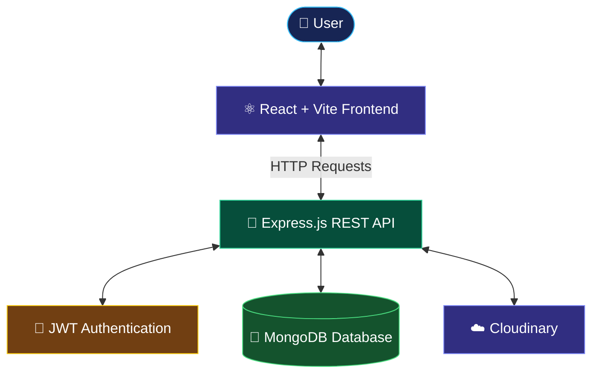
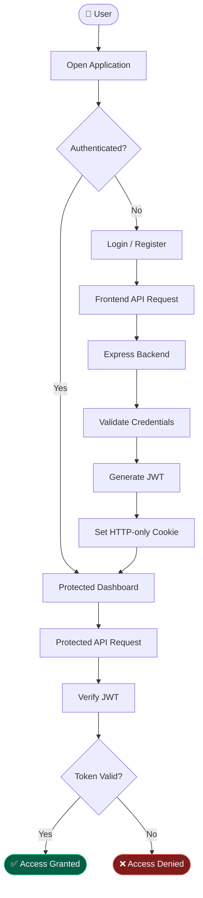
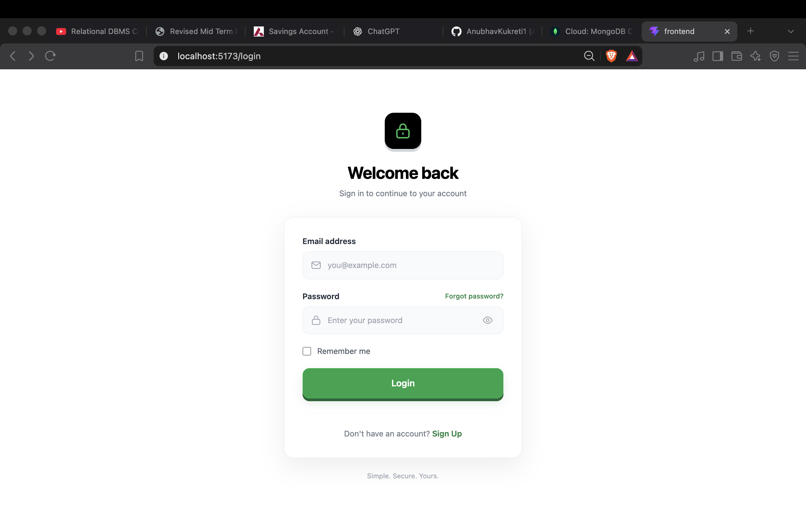
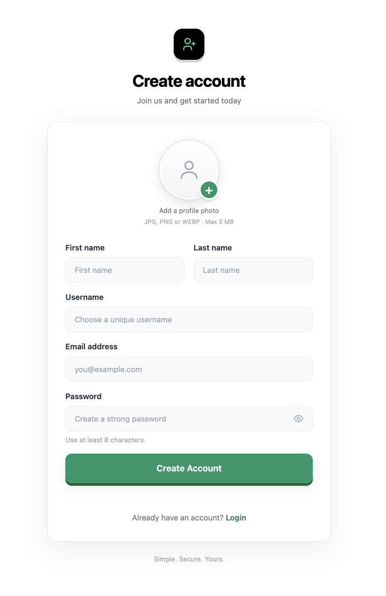
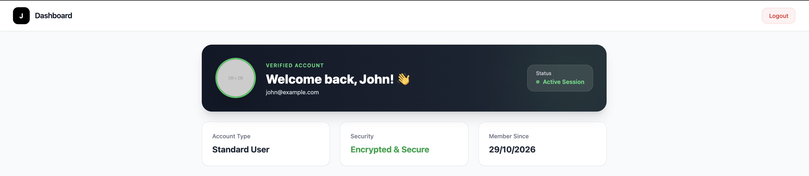

**🚀 MERN Auth | Full-Stack Authentication Platform**

<div align="center">


<br/>

A modern, secure and scalable authentication system built with the MERN stack.

JWT Authentication • HTTP-only Cookies • Protected Routes • Cloudinary Integration

<br/>

<a href="YOUR_LIVE_DEMO_URL">

</a>
<a href="YOUR_GITHUB_REPOSITORY_URL">

</a>

<br/><br/>


<br/>


</div>

✨ About The Project

MERN Auth is a full-stack authentication platform developed using MongoDB, Express.js, React.js and Node.js.

The project provides a secure authentication architecture using JSON Web Tokens (JWT), HTTP-only cookies and protected routes.

Designed with separate frontend and backend environments, it supports both local development and cloud deployment.

The goal is to create a reliable authentication foundation with a clean architecture, secure session handling and a smooth user experience.

🌟 Key Features

<table>
<tr>
<td width="50%">

🔐 Secure Authentication
User registration and login
JWT-based authentication
HTTP-only cookie sessions
Secure token validation

</td>
<td width="50%">

🛡️ Application Security
Protected routes
Authentication middleware
Cross-origin cookie support
Secure production cookies

</td>
</tr>
<tr>
<td width="50%">

☁️ Cloud Integration
Cloudinary integration
Cloud-based media management
Environment-based configuration

</td>
<td width="50%">

⚡ Modern Architecture
React + Vite frontend
Express REST API
MongoDB database
Separate frontend/backend deployment

</td>
</tr>
</table>

🧰 Technology Stack

<div align="center">

Frontend


Backend & Database


Tools & Deployment


<br/>


</div>

🏗️ System Architecture

The application follows a client-server architecture with a dedicated frontend, backend API and database.



📂 Project Structure
```text
mern-auth/
│
├── backend/
│   ├── config/
│   ├── controllers/
│   ├── middleware/
│   ├── models/
│   ├── routes/
│   ├── utils/
│   │
│   ├── .env.example
│   ├── package.json
│   └── server.js
│
├── frontend/
│   ├── public/
│   │
│   ├── src/
│   │   ├── assets/
│   │   ├── components/
│   │   ├── context/
│   │   ├── pages/
│   │   ├── services/
│   │   ├── App.jsx
│   │   └── main.jsx
│   │
│   ├── .env.development
│   ├── .env.production
│   ├── index.html
│   └── package.json
│
└── README.md
 ```


🔄 Authentication Workflow


⚙️ Getting Started

Follow these steps to run the project locally.

Prerequisites

Make sure you have installed:

Node.js
MongoDB
Git
A Cloudinary account
1. Clone the Repository
bash
git clone YOUR_GITHUB_REPOSITORY_URL

cd mern-auth

2. Backend Configuration
bash
cd backend
npm install


Create your environment file:

bash
cp .env.example .env


Configure backend/.env:

env
PORT=8000
NODE_ENV=development

MONGODB_URI=your_mongodb_connection_string

JWT_SECRET=your_jwt_secret

CLOUDINARY_CLOUD_NAME=your_cloudinary_cloud_name
CLOUDINARY_API_KEY=your_cloudinary_api_key
CLOUDINARY_API_SECRET=your_cloudinary_api_secret


Start the backend:

bash
npm run dev


<details>
<summary><b>📌 Backend Information</b></summary>

Configuration	Value
Server	Express.js
Port	8000
Database	MongoDB
Authentication	JWT
Media Service	Cloudinary

</details>

3. Frontend Configuration

Open a new terminal:

bash
cd frontend
npm install


Configure frontend/.env.development:

env
VITE_API_URL=http://localhost:8000


Start the frontend:

bash
npm run dev

4. Run Locally

<div align="center">

Service	Local URL
⚛️ Frontend	http://localhost:5173
🚀 Backend	http://localhost:8000

</div>

🔑 Environment Variables
Variable	Location	Description
VITE_API_URL	Frontend	Backend API base URL
PORT	Backend	Server port
NODE_ENV	Backend	Application environment
MONGODB_URI	Backend	MongoDB connection string
JWT_SECRET	Backend	JWT signing secret
CLOUDINARY_CLOUD_NAME	Backend	Cloudinary account name
CLOUDINARY_API_KEY	Backend	Cloudinary API key
CLOUDINARY_API_SECRET	Backend	Cloudinary API secret
PRODUCTION_FRONTEND_URL	Backend	Production frontend origin

Never expose backend secrets in frontend environment variables or commit your actual backend .env file.

🌍 Deployment Guide

The application uses a split deployment architecture.

<div align="center">


</div>

⚛️ Frontend Deployment — Vercel
Import your GitHub repository into Vercel.
Set the root directory to frontend.
Add the following environment variable:
env
VITE_API_URL=YOUR_RENDER_BACKEND_URL

Deploy the frontend.
🚀 Backend Deployment — Render
Create a new Web Service.
Connect your GitHub repository.
Set the following configuration:
Setting	Configuration
Root Directory	backend
Build Command	npm install
Start Command	npm start
Environment	Node.js
Add your backend environment variables:
env
NODE_ENV=production

PRODUCTION_FRONTEND_URL=https://mern-auth-pqchqu1sr-anubhav-kukreti-s-projects.vercel.app

MONGODB_URI=your_mongodb_connection_string
JWT_SECRET=your_jwt_secret

CLOUDINARY_CLOUD_NAME=your_cloudinary_cloud_name
CLOUDINARY_API_KEY=your_cloudinary_api_key
CLOUDINARY_API_SECRET=your_cloudinary_api_secret

Deploy the backend.
🍪 Production Cookie Security

For cross-origin authentication between Vercel and Render, production JWT cookies use:

Cookie Attribute	Value
HttpOnly	true
SameSite	None
Secure	true

The backend also supports matching Vercel preview URLs under this project's hostname pattern.

Important: Configure CORS with the allowed frontend origins and credentials. Frontend API requests must also include credentials for cookie-based authentication.

📡 API Reference

The following is an illustrative authentication API table. Verify the actual route names and request formats in your backend before publishing.

Method	Endpoint	Description
POST	/api/auth/register	Register a user
POST	/api/auth/login	Authenticate a user
POST	/api/auth/logout	Logout a user
GET	/api/auth/user	Retrieve authenticated user
📸 Application Preview

<div align="center">

Login Experience



Registration Experience



Dashboard



</div>

🔮 Future Roadmap
Email verification.
Forgot password functionality.
Password reset functionality.
Google OAuth integration.
Two-factor authentication.
User profile management.
Enhanced API rate limiting.
Automated testing.
🤝 Contributing

Contributions are always welcome!

Fork this repository.
Create a feature branch.
Commit your changes.
Push your branch.
Submit a Pull Request.

If you find a bug or have a feature request, feel free to open an issue.

👨‍💻 Developer

<div align="center">

Anubhav Kukreti

Full-Stack Developer | MERN Stack Enthusiast

<a href="https://github.com/anubhav-kukreti">

</a>

<br/><br/>

Building secure and scalable web experiences.

</div>

<div align="center">


<br/>

⭐ If you found this project useful, consider giving it a star!

**Author -- Anubhav Kukreti**

</div>
